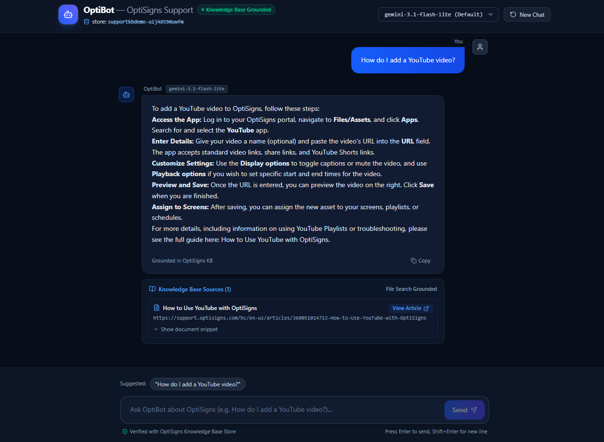

\# Knowledge Base Sync


A one-shot Python worker that synchronizes public OptiSigns Help Center articles to Markdown and indexes changed documents in Google Gemini File Search.


\## How it works


\- Fetches published article metadata from the public Help Center API.

\- Converts article HTML to Markdown while preserving headings, links, and code.

\- Tracks article timestamps and SHA-256 hashes in `state/manifest.json`.

\- On the initial run, indexes up to 30 article bodies and records the remaining articles as a metadata baseline.

\- On later runs, downloads and indexes only new or changed articles. Existing indexed documents are replaced when needed.

\- Logs added, updated, skipped, uploaded, and estimated chunk counts.


Gemini File Search handles document chunking and retrieval. The configured chunk size is 400 tokens with 40 tokens of overlap. Chunk counts in logs are estimates, not exact provider-reported counts.


\## Run locally


Requirements: Python 3.12+ and a Gemini API key with access to File Search.


```bash

pip install -r requirements.txt

```


Create `.env` with `GEMINI\_API\_KEY=your\_key`. Optionally set `GEMINI\_FILE\_SEARCH\_STORE` to reuse an existing store. Run:


```bash

python main.py

```


The worker exits with code `0` on success and `1` on failure. Logs are written to `logs/`.


\## Run with Docker


```bash

docker build -t kb-sync-worker .

docker run --rm -e API\_KEY -e GEMINI\_FILE\_SEARCH\_STORE kb-sync-worker

```


Set `API\_KEY` and `GEMINI\_FILE\_SEARCH\_STORE` in the environment before running. Mount `state/` and `logs/` as volumes when persistence is needed.


\## Daily automation


GitHub Actions runs the worker on a daily schedule and supports manual runs through \*\*Actions → Daily Knowledge Base Sync → Run workflow\*\*. Configure repository secrets `GEMINI\_API\_KEY` and `GEMINI\_FILE\_SEARCH\_STORE`. Logs are uploaded as workflow artifacts and retained for seven days.


Never commit `.env` or API keys.


## Assistant test evidence

Tested “How do I add a YouTube video?” using Gemini File Search. The answer provides five steps and cites the matching OptiSigns support article.



